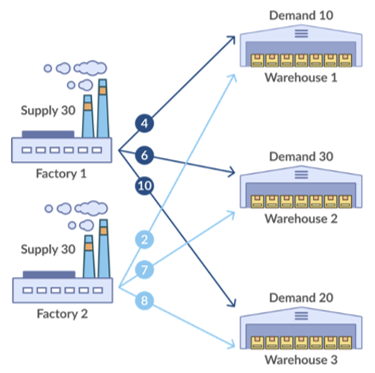
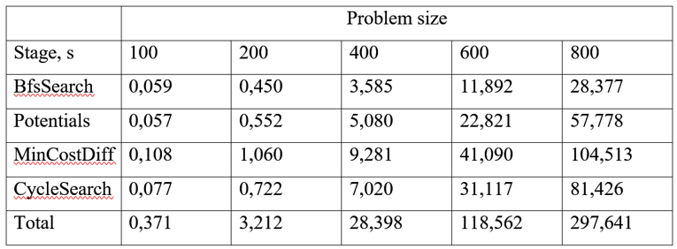

# Transportation Problem Solver

## 📖 What is the Transportation Problem?

The **transportation problem** is a classic optimization problem in operations research.  
It asks: _How can we transport goods from factories to warehouses at the lowest possible cost, while meeting supply and demand constraints?_

- **Factories**: Each has a limited **supply** of goods.
- **Warehouses**: Each has a fixed **demand** that must be satisfied.
- **Transportation costs**: Each path from a factory to a warehouse has a **cost per unit shipped**.

The goal is to **minimize total transportation cost** while ensuring:

1. No factory sends more than its supply.
2. Every warehouse receives its demand.

---

## 🖼️ Example

Here is a simple example with **2 factories** and **3 warehouses**:

- The numbers on the arrows represent **transportation costs**.

The solver finds how much each factory should ship to each warehouse so that:

- All demands are met,
- Supply limits are respected,
- And the **total cost is minimized**.

---

## ⏱️ Performance

The table below shows how much time (in seconds) is spent during different stages of solving the transportation problem for increasing number of factories and warehouses (**100, 200, 400, 600, 800**).

Parallelization allowed speeding up computations by about **2.5 times**.

